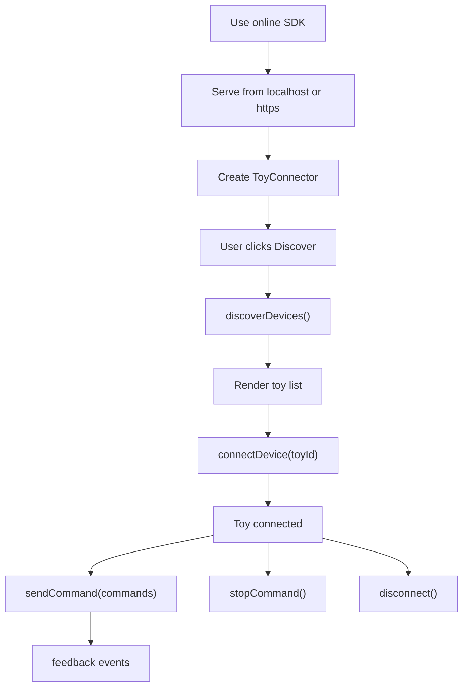

# WASM SDK Device Flow

HoneyPlayBox WASM SDK follows the same integration flow as the standard JS SDK.
The difference is that the SDK logic uses the WebAssembly module internally.

## Flow

1. Use the online SDK file.
2. Serve the page from `localhost` or `https`.
3. Create a `ToyConnector` instance.
4. Check support with `HoneyPlayBox.SDK.isBleSupported()`.
5. Ask the user to click a search or discover button.
6. Call `connector.discoverDevices()`.
7. Render the returned toy list.
8. Let the user select one toy.
9. Call `connector.connectDevice(toyId)`.
10. Store the returned `Toy` instance.
11. Send commands through `toy.sendCommand()` or `connector.sendCommand()`.
12. Listen for `feedback`.
13. Disconnect manually with `toy.disconnect()` or `connector.disconnectDevice(toyId)`.

## Mermaid Flow



## Browser Bridge

WebAssembly cannot directly trigger browser permission prompts or operate browser
Bluetooth objects. The WASM SDK therefore keeps a JavaScript bridge for:

- Browser device authorization.
- GATT connection.
- Characteristic read and write.
- Notification event delivery.

Applications still call the same public SDK methods.

Discovery must be triggered by a user gesture. The Chrome chooser is not the
same as `chrome://bluetooth-internals/`. By default the SDK filters Chrome's
chooser by exact configured BLE name or alias. Devices that are not in product
config are not shown in the permission prompt or returned to the application
list.

## Command And Stop

```js
await toy.sendCommand([
  {
    value: 50,
    duration: 1000,
    function: HoneyPlayBox.SDK.ToyFunctions.Vibrate
  }
]);
```

Use `value` plus `function` as the public command shape. The SDK maps each
function to the toy's internal actuator automatically, so applications do not
need to know low-level motor indexes.

`Vibrate` commands do not automatically send stop after `duration`. Send stop
explicitly when the application needs to stop vibration. `Constrict` commands
with `duration > 0` automatically send stop when the duration ends. When
`duration` is `0`, the command runs until a stop operation is received.

```js
await toy.stopCommand();
```

## Command Mode

Normal mode sends each command call immediately:

```js
toy.setCommandMode(HoneyPlayBox.SDK.ToyCommandMode.normal);
```

Queue mode stores each `sendCommand()` call in that toy's queue. The SDK sends
one payload, waits for the longest `duration` in that payload, and then sends
the next payload. Each connected toy has an independent queue, so queued
commands for one toy do not block queued commands for another toy:

```js
toy.setCommandMode(HoneyPlayBox.SDK.ToyCommandMode.queue);
```

Switching between normal mode and queue mode clears commands that are still
waiting in the selected toy queue and does not send a stop operation.

## Feedback

```js
{
  toyId: "toy-id",
  name: "Vibrosa Mini",
  kind: "battery",
  value: 88,
  unit: "percent",
  time: Date.now()
}
```

Pure command acknowledgements are handled internally and are not emitted as
`feedback`.

