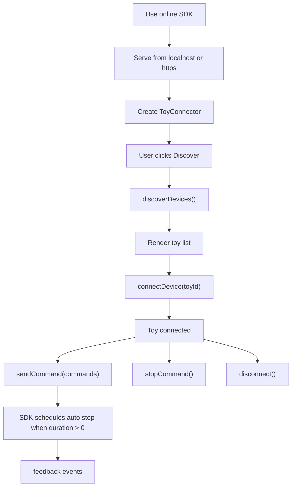

# WASM SDK Device Flow

HoneyPlayBox WASM SDK follows the same integration flow as the standard JS SDK.
The difference is that the SDK logic uses the WebAssembly module internally.

## Flow

1. Use the online SDK file.
2. Serve the page from `localhost` or `https`.
3. Create a `ToyConnector` instance.
4. Check support with `HoneyPlayBox.SDK.isBleSupported()`.
5. Ask the user to click a search or discover button.
6. Call `connector.discoverDevices()`.
7. Render the returned toy list.
8. Let the user select one toy.
9. Call `connector.connectDevice(toyId)`.
10. Store the returned `Toy` instance.
11. Send commands through `toy.sendCommand()` or `connector.sendCommand()`.
12. Listen for `feedback`.
13. Disconnect manually with `toy.disconnect()` or `connector.disconnectDevice(toyId)`.

## Mermaid Flow



## Browser Bridge

WebAssembly cannot directly trigger browser permission prompts or operate browser
Bluetooth objects. The WASM SDK therefore keeps a JavaScript bridge for:

- Browser device authorization.
- GATT connection.
- Characteristic read and write.
- Notification event delivery.

Applications still call the same public SDK methods.

## Command And Stop

```js
await toy.sendCommand([
  {
    vibration: 50,
    motor: 1,
    duration: 1000,
    function: HoneyPlayBox.SDK.ToyFunctions.vibration
  }
]);
```

When `duration` is greater than `0`, the SDK automatically sends stop when the
duration ends. When `duration` is `0`, the toy keeps running until a stop
operation is received.

```js
await toy.stopCommand();
```

## Feedback

```js
{
  toyId: "toy-id",
  name: "Vibrosa Mini",
  kind: "battery",
  value: 88,
  unit: "percent",
  time: Date.now()
}
```

Pure command acknowledgements are handled internally and are not emitted as
`feedback`.
